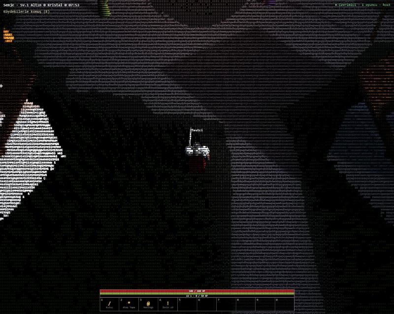

<div align="center">

```
    _    ____   ____ ___ ___     _____ _____ ____  ____      _
   / \  / ___| / ___|_ _|_ _|   |_   _| ____|  _ \|  _ \    / \
  / _ \ \___ \| |    | | | |_____| | |  _| | |_) | |_) |  / _ \
 / ___ \ ___) | |___ | | | |_____| | | |___|  _ <|  _ <  / ___ \
/_/   \_\____/ \____|___|___|    |_| |_____|_| \_\_| \_\/_/   \_\
```

**A dark knight-world action RPG where everything on screen is an ASCII character.**

Grass, armor, castle walls, the sea, fire and rain are all drawn with glyphs — in real time, in your browser.

[](https://github.com/sponsors/emreyigit-tasdelen)
[](https://buymeacoffee.com/emreyigit.tasdelen)

**English** · [Türkçe](README.tr.md)



</div>

---

## What is this?

ASCII-Terra is an open-world ARPG in the spirit of classic dungeon crawlers, but rendered entirely in text.
A 3D scene is drawn off-screen with Three.js, and a custom shader turns every pixel into a glyph chosen
per material: stone walls become dense letter textures, grass becomes `/ | \` strokes that follow each
blade, water is black with white `~ =` foam, fire flickers as orange `# % &`.

You play **Senje**, a knight in silver plate and a red tabard. Clear the undead from the castle ruins,
hunt wolves, defeat the giant spider *Dusk Widow* and take the oath at the Stone Circle.

> Status: early development (v0.2). The long-term goal is an online, multiplayer ASCII MMORPG.
> See the [roadmap](ROADMAP.md).

## Features

- **100% ASCII rendering** — per-material glyph sets, pixel-aligned glyph atlas, finer grid for characters and creatures
- Knight world: village, ruined castle with towers and a torch-lit gate, menhirs on a foamy coast, forests
- Real-time combat: sword combos, shield block and parry with stamina, fireball, whirlwind, dodge roll, jump; bosses telegraph attacks with orange ground circles (dragon fire breath, spider slam)
- Detailed procedural models: plate-armoured knights (layered pauldrons, visored helm, chainmail, tabard, cape, longsword, heraldic shield),
  anatomical skeletons, shaggy dire wolves, a hairy giant spider and a winged, scaled dragon
- Enemies: skeleton warriors, dark knights, dire wolves, the *Dusk Widow* spider boss and the *Ash Dragon* world boss
- New region: the **Misty Swamp** in the east — shallow murky pools, reeds, dead trees, a ruined chapel and graveyard, thick fog
  with ghouls that leap at you, swamp witches casting homing hexes and a club-wielding swamp troll
- Animation: spring-smoothed joints, walk/run blending, hip sway and counter-rotating shoulders, 3-hit sword combo,
  real dodge roll, jumping, hit flinches, cape physics, wolf trot/gallop, spider stepping, segmented dragon neck and tail
- Real-time shadows, shiny metal armour, blood / bone / spark particles, blood decals, hit-stop and camera shake
- 9-quest chain (village + swamp camp)
- **Online co-op multiplayer** with a zero-dependency Node.js server, chat and automatic host migration, inventory and equipment (weapon / armor), loot drops, leveling
- Day / night cycle, rain, auto-save in the browser

## Run it

### Multiplayer (recommended) — Node.js, zero dependencies

```bash
git clone https://github.com/emreyigit-tasdelen/ascii-terra.git
cd ascii-terra
node server/server.js
```

Open <http://localhost:8765>. Friends on the same network open `http://<your-local-ip>:8765` (the server prints the address).
On Windows you can simply double-click `start.bat`. Change the port with `PORT=9000 node server/server.js`.

### Single player only

Any static file server works, e.g. `python -m http.server 8765`. Without the Node server the game silently runs offline.
A WebGL2-capable browser is required; opening `index.html` directly from disk will not work (ES modules).

## Multiplayer

- Up to 32 players share one world. Each knight gets a coloured tabard, a name tag and a health bar.
- **Host-authoritative co-op:** the first visible player simulates enemies and bosses; others receive compact snapshots
  (10 Hz) and send their hits to the host. If the host leaves or switches tab, the role moves to another player automatically.
- Boss ground telegraphs and witch hexes are shared; every client checks damage for its own knight, so dodging stays responsive.
- Kill rewards (XP, loot, quest progress) go to the player who landed the final blow. Quests and inventory are per player.
- Chat: press `Enter`, type, `Enter` to send.
- **Accounts:** register or log in on the start screen to keep your progress on the server and continue from any device,
  or play as a guest (progress stays in that browser). Passwords are stored only as salted scrypt hashes, login tokens only as
  SHA-256 digests, login attempts are rate-limited (5/min per IP), and all of it lives in `server/data/` which is git-ignored.
- **Database:** Node's built-in SQLite (`node:sqlite`, Node 22.5+, nothing to install) in `server/data/terra.db`, WAL mode,
  batched save writes, daily backups in `server/data/backups/` (last 7 kept). An old `users.json` is imported automatically.
- **Forgot password:** on sign-up you get a one-time **recovery code**; "Forgot password" + name + code sets a new password
  (no e-mail is stored). Admin CLI: `node server/admin.js list | reset <name> | ban <name> | unban <name> | delete <name> --yes | backup`.
- The server is a single dependency-free file (`server/server.js`): static files + a minimal WebSocket implementation,
  path-traversal and dotfile protection, message size and rate limits, sanitised names and chat.
- To play over the internet, run the server on a VPS or any Node host and put it behind HTTPS; the client switches to `wss://` automatically.

## Controls

| Key | Action |
|---|---|
| `W A S D` | move (`Shift` to run) |
| `Space` | jump |
| `C` | dodge roll |
| Left click / `1` | sword attack toward the cursor (3-hit combo) |
| `Alt` (hold) | raise shield — block frontal hits; block right on impact to **parry** and stagger the enemy |
| `2` / `3` | fireball / whirlwind |
| `4` / `Q` | drink a potion |
| `E` | talk to NPCs |
| `Enter` | chat (multiplayer) |
| `Esc` / `P` | pause menu (closes open windows first) |
| `I` / `M` | inventory / map |
| `R` | toggle rain |
| Right- or middle-drag, arrow keys, wheel | rotate / tilt (down to the horizon) / zoom camera |
| `[` `]` | glyph size |

## How the ASCII renderer works

1. The scene is rendered at full resolution into an off-screen target.
2. Every material writes a **material ID** into the alpha channel (`src/core.js` → `MID`).
   Grass also encodes the on-screen angle of each blade.
3. A full-screen pass (`src/render.js`) splits the screen into glyph cells, samples each cell
   3×3 times and picks a glyph from the set that belongs to that material, coloured by the scene.
4. Thin objects (rain, webs, flowers) claim a cell if any sample hits them, so 1-pixel lines never vanish.

Details: [docs/STYLE-GUIDE.md](docs/STYLE-GUIDE.md) (style guide).

## Project structure

```
index.html, style.css   entry page and HUD styles
src/core.js             math, noise, terrain height, collisions, material IDs
src/render.js           renderer, ASCII post-process, day/night, rain
src/world.js            terrain, sea, grass, trees, village, castle, coast, crystals, spider lair
src/models.js           knight, NPC, skeleton, wolf and spider models + animation
src/actors.js           player, enemy AI, skills, projectiles, telegraphs
src/fx.js               particles, blood decals, hit-stop, camera shake
src/game.js             state, items, quests, dialogue, save, HUD
src/net.js              multiplayer client: remote knights, chat, enemy snapshots
src/main.js             input, camera, main loop
server/server.js        zero-dependency Node.js server (static files + WebSocket)
legacy/                 the original single-file prototype
```

## Support

ASCII-Terra is developed in the open. If you enjoy it, you can support development:

- GitHub Sponsors: <https://github.com/sponsors/emreyigit-tasdelen>
- Buy Me a Coffee: <https://buymeacoffee.com/emreyigit.tasdelen>

## Contributing

Issues and pull requests are welcome. Please keep the core rule: everything that appears on screen must be ASCII.

## License

[MIT](LICENSE)
