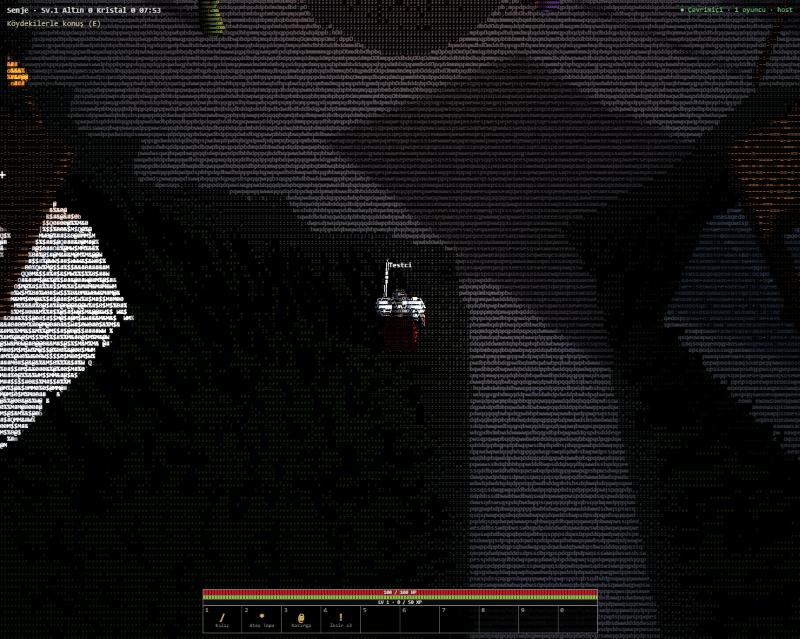

<div align="center">

```
    _    ____   ____ ___ ___     _____ _____ ____  ____      _
   / \  / ___| / ___|_ _|_ _|   |_   _| ____|  _ \|  _ \    / \
  / _ \ \___ \| |    | | | |_____| | |  _| | |_) | |_) |  / _ \
 / ___ \ ___) | |___ | | | |_____| | | |___|  _ <|  _ <  / ___ \
/_/   \_\____/ \____|___|___|    |_| |_____|_| \_\_| \_\/_/   \_\
```

### A dark knight-world action RPG where everything on screen is an ASCII character.

Grass, armor, castle walls, the sea, fire and rain are all drawn with glyphs, in real time, in your browser.<br>
Play solo, with friends on your LAN, or from a tablet.

[](https://github.com/emreyigit-tasdelen/ascii-terra/releases)
[](LICENSE)


[](https://github.com/sponsors/emreyigit-tasdelen)
[](https://buymeacoffee.com/emreyigit.tasdelen)

**English** · [Türkçe](README.tr.md)



</div>

---

## Quick start

Detailed guide: [docs/INSTALL.md](docs/INSTALL.md).

**Windows:** download the [latest release](https://github.com/emreyigit-tasdelen/ascii-terra/releases/latest), unzip it and double-click **`start.bat`**. The game opens in your browser.

**Any system with [Node.js](https://nodejs.org) 22.5+:**

```bash
git clone https://github.com/emreyigit-tasdelen/ascii-terra.git
cd ascii-terra
node server/server.js
```

Then open <http://localhost:8765>. No `npm install`, nothing to build.

> **Updates:** `start.bat` checks GitHub for a new release every time you start and installs it for you.
> Your accounts and saves (`server/data/`) are never touched.

## What is this?

ASCII-Terra is an open-world ARPG in the spirit of classic dungeon crawlers, rendered entirely in text.
A 3D scene is drawn off-screen with Three.js, and a custom shader turns every pixel into a glyph chosen
per material: stone walls become dense letter textures, grass becomes `/ | \` strokes that follow each
blade, water is black with white `~ =` foam, fire flickers as orange `# % &`.

You play **Torvan**, a knight in silver plate and a red tabard. Clear the undead from the castle ruins,
hunt wolves, defeat the giant spider *Gloomweaver* and take the oath at the Stone Circle.

> **Status:** early development. The long-term goal is an online, multiplayer ASCII MMORPG. See the [roadmap](ROADMAP.md).

## Highlights

| | |
|---|---|
| **100% ASCII** | Per-material glyph sets, a pixel-aligned glyph atlas and a finer grid for characters and creatures. Real-time shadows, shiny armor, particles, day/night, rain and fog. |
| **Combat** | Sword combos, shield block and **parry** with stamina, fireball, whirlwind, void orb, moon lance, dodge roll, jump, horse. Bosses telegraph attacks with ground circles and enrage below half health. |
| **World** | Village, ruined castle with a torch-lit gate, a foamy coast with menhirs, forests, and the fog-bound **Misty Swamp**. A world map, a 9-quest chain, loot drops and a crafting table (blade and armor with runes). |
| **Creatures** | Skeletons, dark knights, dire wolves that flee when hurt, ghouls, swamp witches and trolls, the spider *Gloomweaver* and the winged *Ash Dragon*, all procedural models with full animation. |
| **Multiplayer** | Up to 32 players, host-authoritative co-op with automatic host migration, chat, **parties** with shared XP and quests, **PvP duels**, accounts with server-side saves. |
| **Touch devices** | Floating joystick, swipe-to-look and aim, pinch zoom and action buttons on iPad and Android tablets. Desktop controls are unchanged. |

## Play with friends (LAN party)

Run `start.bat` on one PC. The server prints the address for the others:

```
For friends on your local network → http://192.168.x.x:8765
```

Everyone on the same network opens that address in a browser, on a PC or a tablet.
If Windows asks, allow Node.js on **private networks**. To play over the internet, run the server on a VPS behind HTTPS; the client switches to `wss://` automatically.

## Tablets (iPad and Android)

Open the LAN address in Safari or Chrome and turn the tablet sideways.

- **Left side:** drag to walk, push to the rim to run
- **Right side:** swipe to turn the camera and aim, pinch to zoom
- **Buttons:** attack, shield, jump, roll, skills, potion, use, horse, inventory, map, craft, chat
- Add the page to the home screen on iPad for a full-screen game

## Controls (keyboard and mouse)

| Key | Action |
|---|---|
| `W A S D` / `Shift` | move / run |
| `Space` / `C` | jump / dodge roll |
| Left click or `1` | sword attack toward the cursor (3-hit combo) |
| `Alt` (hold) | shield; block right on impact to **parry** |
| `2` `3` `5` `6` | fireball, whirlwind, void orb, moon lance |
| `4` / `Q` | potion |
| `E` / `F` | talk / horse |
| `I` `K` `M` `N` | inventory, craft, world map, minimap |
| `Enter` | chat |
| `G` / `J` | duel / party invite (`Y` accept, `N` decline) |
| `Esc` / `P` | pause menu (keys can be rebound there) |
| Right-drag, arrows, wheel | camera |

Full list: press `H` in the game. New games start with character creation and a short tutorial.

## Multiplayer in detail

- **Host-authoritative co-op:** the first visible player simulates enemies and bosses; others receive compact snapshots (10 Hz) and send their hits to the host. If the host leaves, the role moves to another player.
- Kill rewards go to the player who landed the final blow; party members nearby share XP and quest kill counts.
- **Accounts:** register on the start screen to keep progress on the server, or play as a guest (progress stays in that browser). Passwords are stored as salted scrypt hashes, login tokens as SHA-256 digests, logins are rate-limited, and everything lives in `server/data/`, which is git-ignored.
- **Database:** Node's built-in SQLite (`node:sqlite`), WAL mode, daily backups (last 7 kept). Password recovery uses a one-time recovery code; no e-mail is stored.
- **Admin CLI:** `node server/admin.js list | reset <name> | ban <name> | unban <name> | delete <name> --yes | backup`
- The server is dependency-free: static files and a minimal WebSocket in plain Node, with path-traversal protection and message size and rate limits.

## How the ASCII renderer works

1. The scene is rendered at full resolution into an off-screen target.
2. Every material writes a **material ID** into the alpha channel (`src/core.js`). Grass also encodes the on-screen angle of each blade.
3. A full-screen pass (`src/render.js`) splits the screen into glyph cells, samples each cell 3×3 times and picks a glyph from the set that belongs to that material, coloured by the scene.
4. Thin objects (rain, webs, flowers) claim a cell if any sample hits them, so 1-pixel lines never vanish.

Details: [docs/STYLE-GUIDE.md](docs/STYLE-GUIDE.md)

## Project structure

```
index.html, style.css   entry page and HUD styles
src/core.js             math, noise, terrain height, collisions, material IDs
src/render.js           renderer, ASCII post-process, day/night, rain
src/world.js            terrain, sea, grass, trees, village, castle, swamp
src/models.js           character models and animation
src/actors.js           player, enemy AI, skills, projectiles
src/game.js             state, items, quests, dialogue, save, HUD
src/net.js, duel.js, party.js   multiplayer client, duels, parties
src/touch.js            touch controls for tablets
src/main.js             input, camera, main loop
server/                 zero-dependency Node.js server, SQLite, admin CLI
update.bat              release updater (called by start.bat)
```

## Support

ASCII-Terra is developed in the open. If you enjoy it, you can support development:
[GitHub Sponsors](https://github.com/sponsors/emreyigit-tasdelen) · [Buy Me a Coffee](https://buymeacoffee.com/emreyigit.tasdelen)

## Contributing

Issues and pull requests are welcome. Please keep the core rule: **everything that appears on screen must be ASCII.**

## License

[MIT](LICENSE)
