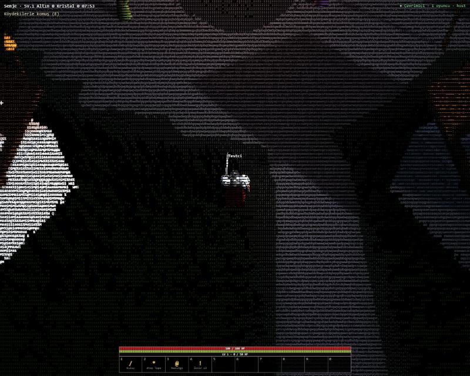

<div align="center">

```
    _    ____   ____ ___ ___     _____ _____ ____  ____      _
   / \  / ___| / ___|_ _|_ _|   |_   _| ____|  _ \|  _ \    / \
  / _ \ \___ \| |    | | | |_____| | |  _| | |_) | |_) |  / _ \
 / ___ \ ___) | |___ | | | |_____| | | |___|  _ <|  _ <  / ___ \
/_/   \_\____/ \____|___|___|    |_| |_____|_| \_\_| \_\/_/   \_\
```

**Ekrandaki her şeyin ASCII karakterlerinden oluştuğu karanlık bir şövalye dünyası aksiyon RPG'si.**

Çimen, zırh, kale surları, deniz, ateş ve yağmur; hepsi gerçek zamanlı olarak, tarayıcında, karakterlerle çizilir.

[](https://github.com/sponsors/emreyigit-tasdelen)
[](https://buymeacoffee.com/emreyigit.tasdelen)

[English](README.md) · **Türkçe**



</div>

---

> Not: oyunun arayüzü ve kodu İngilizcedir; bu dosya README.md'nin Türkçe çevirisidir.

## Nedir?

ASCII-Terra, klasik zindan oyunlarının ruhunu taşıyan ama tamamen metinle çizilen bir açık dünya ARPG'si.
3B sahne Three.js ile ekran dışına çizilir; özel bir shader her pikseli malzemesine göre seçilmiş bir glife
çevirir: taş surlar yoğun harf dokusuna, çimen her sapın yönünü izleyen `/ | \` çizgilerine, deniz beyaz
`~ =` köpüklü siyaha, ateş turuncu `# % &` titreşimine dönüşür.

**Torvan**'yi oynarsın: gümüş plaka zırhlı, kırmızı tabardlı bir şövalye. Kale harabesindeki ölüleri temizle,
kurtları avla, dev örümcek *Kasvet Dokuyan*'nu yen ve Taş Çember'de yemini al.

> Durum: erken geliştirme (v0.2). Uzun vadeli hedef çevrim içi, çok oyunculu bir ASCII MMORPG.
> Ayrıntılar: [yol haritası](ROADMAP.md).

## Özellikler

- **%100 ASCII çizim** — malzemeye özel glif setleri, piksel hizalı glif atlası, karakter ve yaratıklar için ince ızgara
- Şövalye dünyası: köy, kuleli ve meşaleli kapılı kale harabesi, köpüklü kıyıda menhirler, ormanlar
- Gerçek zamanlı dövüş: kılıç kombosu, dayanıklılıklı kalkan bloğu ve savuşturma, ateş topu, kasırga, boşluk küresi, ay mızrağı, yuvarlanma, zıplama; prosedürel ses; yere düşen ganimet; örümcek boss yavaşlatan ağlar örer; bosslar saldırıyı yerde turuncu dairelerle haber verir (ejderha ateş nefesi, örümcek darbesi)
- Detaylı prosedürel modeller: plaka zırhlı şövalyeler (katmanlı omuzluk, vizörlü miğfer, zincir zırh, tabard, pelerin, uzun kılıç, armalı kalkan),
  gerçek kemik yapılı iskeletler, tüylü dev kurtlar, kıllı dev örümcek ve kanatlı, pullu bir ejderha
- Düşmanlar: iskelet savaşçılar, kara şövalyeler, kara kurtlar, boss *Kasvet Dokuyan* ve dünya bossu *Kül Ejderhası*
- Yeni bölge: doğuda **Sisli Bataklık** — sığ çamurlu gölcükler, sazlık, kuru ağaçlar, yıkık şapel ve mezarlık, yoğun sis;
  üstüne atılan hortlaklar, güdümlü lanet fırlatan bataklık cadıları ve sopalı bataklık trolü
- Animasyon: yaylı eklemler, yürüme/koşma geçişi, kalça sallanması ve omuz karşı dönüşü, 3 vuruşluk kılıç kombosu,
  gerçek takla, zıplama, darbe sarsılması, fizikli pelerin, kurtta tırıs/dörtnala, örümcek adımı, eklemli ejderha boynu ve kuyruğu
- Gerçek zamanlı gölgeler, parlayan metal zırh, kan / kemik / kıvılcım parçacıkları, yerde kan izleri, vuruş durması ve kamera sarsıntısı
- 9 görevlik zincir (köy + bataklık kampı)
- **Çevrim içi ortak çok oyunculu**: bağımlılıksız Node.js sunucusu, sohbet ve otomatik host devri, envanter ve ekipman (silah / zırh), düşen eşyalar, seviye atlama
- Gece / gündüz döngüsü, yağmur, tarayıcıda otomatik kayıt

## Çalıştırma

### Çok oyunculu (önerilen) — Node.js, sıfır bağımlılık

```bash
git clone https://github.com/emreyigit-tasdelen/ascii-terra.git
cd ascii-terra
node server/server.js
```

<http://localhost:8765> adresini aç. Aynı ağdaki arkadaşların `http://<yerel-ip-adresin>:8765` adresine girer (sunucu adresi ekrana yazar).
Windows'ta `start.bat`'a çift tıklaman yeterli. Portu `PORT=9000 node server/server.js` ile değiştirebilirsin.

### Yalnız tek oyunculu

Herhangi bir statik dosya sunucusu olur, ör. `python -m http.server 8765`. Node sunucusu yoksa oyun sessizce çevrimdışı çalışır.
WebGL2 destekli bir tarayıcı gerekir; `index.html`'e diskten çift tıklamak çalışmaz (ES modülleri).

## Çok oyunculu

- 32 oyuncuya kadar aynı dünyayı paylaşır. Her şövalyenin renkli tabardı, isim etiketi ve can çubuğu vardır.
- **Host yetkili ortak oyun:** ilk görünür oyuncu düşmanları ve bossları çalıştırır; diğerleri sıkıştırılmış anlık görüntüler alır
  (10 Hz) ve vuruşlarını host'a gönderir. Host çıkarsa ya da sekmesini değiştirirse rol otomatik olarak başka oyuncuya geçer.
- Boss uyarı daireleri ve cadı lanetleri herkese gider; her istemci hasarı kendi şövalyesi için kontrol eder, böylece kaçmak gecikmesiz kalır.
- Öldürme ödülleri (XP, ganimet, görev ilerlemesi) son darbeyi vurana gider. Görevler ve envanter oyuncuya özeldir.
- Sohbet: `Enter`'a bas, yaz, `Enter` ile gönder.
- **Hesaplar:** giriş ekranında kayıt olup giriş yaparsan ilerlemen sunucuda saklanır ve her cihazdan devam edersin;
  ya da misafir oynarsın (ilerleme o tarayıcıda kalır). Şifreler yalnız tuzlanmış scrypt karması, oturum belirteçleri yalnız SHA-256
  özeti olarak tutulur; giriş denemeleri sınırlıdır (IP başına dakikada 5) ve hepsi git'e girmeyen `server/data/` klasöründedir.
- **Veritabanı:** Node'un yerleşik SQLite'ı (`node:sqlite`, Node 22.5+, kurulum gerekmez), dosya `server/data/terra.db`, WAL modu,
  kayıtlar toplu yazılır, her gün `server/data/backups/` altına yedek alınır (son 7). Eski `users.json` otomatik içe aktarılır.
- **Şifremi unuttum ("Forgot password"):** kayıtta bir kez **kurtarma kodu** gösterilir; ad + kod ile yeni şifre belirlenir (e-posta tutulmaz).
  Yönetim: `node server/admin.js list | reset <ad> | ban <ad> | unban <ad> | delete <ad> --yes | backup`.
- Sunucu tek, bağımlılıksız bir dosyadır (`server/server.js`): statik dosyalar + küçük bir WebSocket uygulaması,
  yol gezinmesi ve gizli dosya koruması, mesaj boyutu ve hız sınırları, temizlenmiş isim ve sohbet.
- İnternet üzerinden oynamak için sunucuyu bir VPS'te ya da herhangi bir Node barındırmada HTTPS arkasında çalıştır; istemci otomatik olarak `wss://` kullanır.

## Kontroller

| Tuş | Eylem |
|---|---|
| `W A S D` | yürü (`Shift` ile koş) |
| `Boşluk` | zıpla |
| `C` | yuvarlan |
| Sol tık / `1` | imlece doğru kılıç (3 vuruşluk kombo) |
| `Alt` (basılı) | kalkanı kaldır — önden gelen darbeyi blokla; tam darbe anında basarsan **savuşturma**, düşman sendeler |
| `2` / `3` | ateş topu / kasırga |
| `5` / `6` | boşluk küresi (düşmanları içine çeker, sonra patlar) / ay mızrağı (bir hat boyunca ışın) |
| `4` / `Q` | iksir iç |
| `E` | NPC ile konuş |
| `F` | atı çağır / bin / in (daha hızlı; binerken yuvarlanma ve zıplama yok) |
| — | yeni oyun karakter yaratmayla (tabard, pelerin, arma) ve eğitim kuklalı kısa bir öğreticiyle başlar |
| `K` | üretim: kılıç (metal + 3 rün) ve altı zırh parçası (her biri metal + 2 rün: savunma, can, yenilenme, hız, diken) |
| `Enter` | sohbet (çok oyunculu) |
| `Esc` / `P` | duraklatma menüsü (önce açık pencereyi kapatır) |
| `I` / `M` / `N` | envanter / dünya haritası (tekerlek yakınlaştırır, sürükle kaydırır) / mini harita |
| `O` | sesi aç / kapat (ses seviyesi duraklatma menüsünde) |
| `G` | yakındaki oyuncuya düello teklif et (`Y` kabul / `N` reddet); halkadan çıkan veya 1 HP'ye düşen kaybeder |
| `J` | yakındaki oyuncuyu partiye davet et (`Y` / `N`) ya da `/invite <isim>` yaz; `/leave` ile çıkılır. En çok 4 üye, yakındaki üyeler öldürme XP'sini paylaşır (+%10) |
| — | öldürülen düşmanlar yere etiketli ganimet bırakır; üstünden geçince alınır (yerde kalan ganimet kaydedilir) |
| `R` | yağmuru aç / kapat |
| `T` | günün saatini 3 saat ileri al |
| Sağ ya da orta tuşla sürükle, ok tuşları, tekerlek | kamerayı döndür / ufka kadar eğ / yakınlaştır |
| `[` `]` | harf boyutu |

## ASCII çizici nasıl çalışır?

1. Sahne tam çözünürlükte ekran dışı bir hedefe çizilir.
2. Her malzeme alfa kanalına bir **malzeme kimliği** yazar (`src/core.js` → `MID`). Çimen ayrıca her sapın ekrandaki açısını taşır.
3. Tam ekran bir geçiş (`src/render.js`) ekranı glif hücrelerine böler, her hücreyi 3×3 örnekler ve o malzemenin glif setinden, sahne rengiyle boyanmış bir karakter seçer.
4. İnce nesneler (yağmur, ağ, çiçek) tek bir örneğe bile değse hücreyi alır; 1 piksellik çizgiler kaybolmaz.

Ayrıntılar: [docs/STYLE-GUIDE.md](docs/STYLE-GUIDE.md) (İngilizce).

## Proje yapısı

```
index.html, style.css   giriş sayfası ve arayüz stilleri
src/core.js             matematik, gürültü, arazi yüksekliği, çarpışma, malzeme kimlikleri
src/render.js           renderer, ASCII son-işleme, gece/gündüz, yağmur
src/world.js            arazi, deniz, çimen, ağaçlar, köy, kale, kıyı, kristaller, örümcek yuvası
src/models.js           şövalye, NPC, iskelet, kurt ve örümcek modelleri + animasyon
src/actors.js           oyuncu, düşman yapay zekâsı, beceriler, mermiler, uyarı daireleri
src/fx.js               parçacıklar, kan izleri, vuruş durması, kamera sarsıntısı
src/game.js             durum, eşyalar, görevler, diyalog, kayıt, arayüz
src/net.js              çok oyunculu istemci: diğer şövalyeler, sohbet, düşman anlık görüntüleri
src/main.js             girdi, kamera, ana döngü
server/server.js        bağımlılıksız Node.js sunucusu (statik dosyalar + WebSocket)
legacy/                 ilk tek dosyalık prototip
```

## Destek

ASCII-Terra açık geliştiriliyor. Beğendiysen geliştirmeye destek olabilirsin:

- GitHub Sponsors: <https://github.com/sponsors/emreyigit-tasdelen>
- Buy Me a Coffee: <https://buymeacoffee.com/emreyigit.tasdelen>

## Katkı

Issue ve pull request'ler açıktır. Tek temel kural: ekranda görünen her şey ASCII olmalı.

## Lisans

[MIT](LICENSE)
