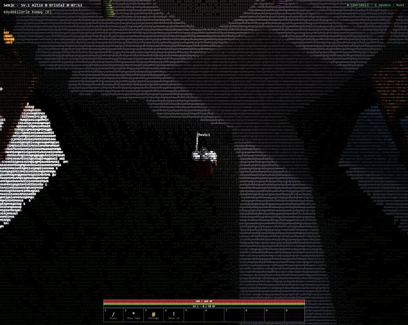
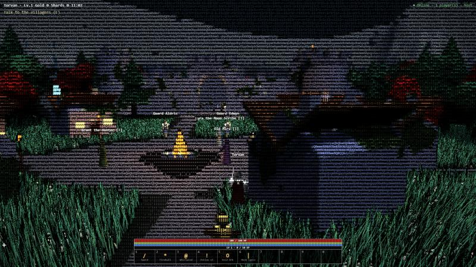

<div align="center">

```
    _    ____   ____ ___ ___     _____ _____ ____  ____      _
   / \  / ___| / ___|_ _|_ _|   |_   _| ____|  _ \|  _ \    / \
  / _ \ \___ \| |    | | | |_____| | |  _| | |_) | |_) |  / _ \
 / ___ \ ___) | |___ | | | |_____| | | |___|  _ <|  _ <  / ___ \
/_/   \_\____/ \____|___|___|    |_| |_____|_| \_\_| \_\/_/   \_\
```

### Her piksel bir harf.

Tamamen ASCII karakterlerle, gerçek zamanlı ve tarayıcıda çizilen karanlık şövalye aksiyon RPG'si.

[](https://github.com/emreyigit-tasdelen/ascii-terra/releases)
[](LICENSE)


[English](README.md) · **Türkçe**


<br><br>


**[Hızlı başlangıç](#hızlı-başlangıç)** · [Kurulum rehberi](docs/INSTALL.tr.md) · [Yol haritası](ROADMAP.md)

</div>

---

## Bu nedir?

ASCII-Terra, görüntünün metinden oluştuğu açık dünya bir aksiyon RPG'si. Taş duvarlar yoğun harf dokusu,
çimen her yaprağı izleyen `/ | \` çizgileri, su siyah zemin üstünde beyaz `~ =` köpüğü, ateş turuncu `# % &` olarak titriyor.
Yağmur ve deniz bile harflerden oluşuyor.

Gümüş zırhlı şövalye **Torvan**'ı oynarsın. Kale harabesindeki ölümsüzleri temizle, kurtları avla, sisli bataklığı geç,
dev örümcek *Gloomweaver*'ı yen ve Taş Çember'de yemin et. Tek başına, ağındaki arkadaşlarla ya da tabletten oyna.

> **Durum:** erken geliştirme. Uzun vadeli hedef çevrimiçi bir ASCII MMORPG. [Yol haritası](ROADMAP.md).

## Neden farklı görünüyor?

- **Altında gerçek bir 3D sahne var.** Three.js dünyayı gölge, parlak zırh ve parçacıklarla ekran dışına çizer. Özel bir shader sonra onu metne çevirir.
- **Karakter malzemeye göre seçilir.** Taş, çimen, su, metal ve ateşin her birinin kendi karakter seti var; yüzey ne olduğunu kendisi söyler.
- **Ekrandaki hiçbir şey resim değil.** Karakterler, yaratıklar ve efektler harflerden kurulu. Projenin tek kuralı bu.

## Hızlı başlangıç

Oyun tarayıcıda çalışır ama küçük bir yerel sunucu ister (içinde geliyor, kurulum adımı ve paket yok).

**Windows:** [son sürümü](https://github.com/emreyigit-tasdelen/ascii-terra/releases/latest) indir, ZIP'i aç, **`start.bat`**'a çift tıkla.

**[Node.js](https://nodejs.org) 22.13+ olan her sistem:**

```bash
git clone https://github.com/emreyigit-tasdelen/ascii-terra.git
cd ascii-terra
node server/server.js     # sonra http://localhost:8765 adresini aç
```

`start.bat` her açılışta oyunu GitHub sürümlerinden günceller ve hesaplarına, kayıtlarına hiç dokunmaz.
Adım adım anlatım, güvenlik duvarı ve sorun giderme: **[docs/INSTALL.tr.md](docs/INSTALL.tr.md)**.

## Öne çıkanlar

| | |
|---|---|
| **Savaş** | Kılıç kombosu, kalkan ve **savuşturma**, ateş topu, kasırga, boşluk küresi, ay mızrağı, yuvarlanma, zıplama, at. Boss'lar saldırıyı yerde daireyle gösterir, canı yarıya inince öfkelenir. |
| **Dünya** | Köy, kale harabesi, dikilitaşlı köpüklü kıyı, ormanlar ve Misty Swamp. Dünya haritası, 9 görevlik zincir, yere düşen ganimet, kılıç ve zırh için rün demirciliği. |
| **Yaratıklar** | İskeletler, kara şövalyeler, yaralanınca kaçan kurtlar, ghoul'ler, cadılar, bir trol, örümcek *Gloomweaver* ve *Ash Dragon*. |
| **Çok oyunculu** | 32 oyuncuya kadar, otomatik host devriyle co-op, sohbet, ortak XP ve görevli partiler, PvP düello, sunucuda kayıtlı hesaplar. |
| **Tabletler** | iPad ve Android: sanal joystick, kaydırarak bakma ve nişan, iki parmakla yakınlaştırma, aksiyon düğmeleri. |
| **Atmosfer** | Gece ve gündüz, yağmur, sis, vuruş duraksaması, kamera sarsıntısı, kodla üretilen ses. |

## Arkadaşlarla ve tabletle oyna

1. `start.bat`'i **bir bilgisayarda** çalıştır. Sunucu odur.
2. Konsol `For friends on your local network → http://192.168.x.x:8765` yazar.
3. Aynı ağdaki herkes bu adresi bilgisayarda ya da tablette açar. Tableti yatay tut.

Tablette sol yarıyı sürükleyerek yürürsün, sağ yarıyı kaydırarak bakar ve nişan alırsın, iki parmakla yakınlaştırırsın.
İnternet üzerinden oynamak için sunucuyu HTTPS arkasında bir VPS'e koy (istemci otomatik `wss://` kullanır). Ayrıntılar [kurulum rehberinde](docs/INSTALL.tr.md).

## Kontroller

| Tuş | İşlev |
|---|---|
| `W A S D` / `Shift` | yürü / koş |
| `Space` / `C` | zıpla / yuvarlan |
| Sol tık ya da `1` | kılıç, 3'lü kombo |
| `Alt` (basılı) | kalkan; darbe anında doğru zamanda bloklarsan savuşturursun |
| `2` `3` `5` `6` | ateş topu, kasırga, boşluk küresi, ay mızrağı |
| `E` `F` `I` `K` `M` | konuş, at, envanter, demircilik, harita |
| `Enter` / `G` / `J` | sohbet / düello / parti daveti |
| `Esc` | duraklatma menüsü, tuş ataması |

Gerisi için oyunda `H` tuşuna bas.

## Çizici nasıl çalışır

1. Sahne tam çözünürlükte ekran dışı bir hedefe çizilir.
2. Her malzeme alfa kanalına bir **malzeme kimliği** yazar. Çimen ayrıca her yaprağın ekran açısını saklar.
3. Tam ekran bir geçiş ekranı karakter hücrelerine böler, her hücreyi 3×3 örnekler ve o malzemenin setinden bir karakter seçip sahnenin rengiyle boyar.
4. İnce şeyler (yağmur, ağ, çiçek) herhangi bir örnek isabet ederse hücreyi sahiplenir; 1 piksellik çizgiler kaybolmaz.

Kod: `src/core.js` (malzeme kimlikleri), `src/render.js` (geçiş). Stil kuralları: [docs/STYLE-GUIDE.md](docs/STYLE-GUIDE.md).

## Proje yapısı

```
src/core.js, render.js     matematik, arazi, malzeme kimlikleri, ASCII geçişi
src/world.js, models.js    arazi, kale, bataklık, karakterler ve animasyon
src/actors.js, game.js     oyuncu, düşman yapay zekâsı, yetenekler, görevler, eşyalar, arayüz
src/net.js, duel.js, party.js, touch.js   çok oyunculu, düello, parti, tablet kontrolleri
server/                    bağımlılıksız Node.js sunucusu, SQLite, yönetici CLI
start.bat, update.bat      başlatıcı ve sürüm güncelleyici
```

## Destek

Açık geliştirilir. Beğendiysen:
[GitHub Sponsors](https://github.com/sponsors/emreyigit-tasdelen) · [Buy Me a Coffee](https://buymeacoffee.com/emreyigit.tasdelen)

## Katkı

Issue ve pull request'ler memnuniyetle karşılanır. Tek kural: **ekranda görünen her şey ASCII olmalı.**

## Lisans

[MIT](LICENSE)
