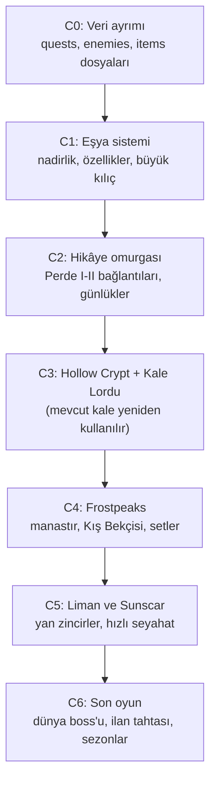

# İçerik Planı: Hikâye, Harita, Canavarlar, Eşyalar, Görevler

Durum: taslak (2026-11-20). Kod yazılmadı; bu belge karar vermek içindir. Mevcut içeriğe (9 görev, 8 düşman türü, 7 bölge) dayanır.

## 0. Özet (bir bakışta)

- **Çekirdek fikir:** "Ay Çatlağı". Yüz yıl önce Gümüş Yemin Tarikatı'nın şövalyeleri, gökten düşen Ay Kırığı'nın gücüyle bir kaleyi yönetti. Kale Lordu ölümü yenmek istedi ve ölüler kalktı. Şimdi mühür zayıflıyor, gökten yeniden kırıklar düşüyor. Torvan, mührü yenileyecek son şövalye.
- **Elimizde zaten olanlar hikâyeyi taşıyor:** Ay Kırıkları (Lyra), Moonsteel eşyalar, Taş Çember'deki yemin, kaledeki hortlayan iskeletler, bataklıktaki mezarlık ve rahip, "yüz yıl" diyen Mira. Yeni bir dünya icat etmiyoruz, mevcut parçaları birbirine bağlıyoruz.
- **En büyük risk içerik değil, 3D model ve ses üretimi.** Plan bu yüzden mevcut modelleri yeniden renklendirip ölçekleyerek çeşitlilik üretmeyi öne alır.
- **Sıra:** (1) veri altyapısı ve eşya sistemi → (2) hikâye omurgası + Kale Lordu → (3) Frostpeaks → (4) Kıyı ve Çöl → (5) son oyun ve MMO etkinlikleri.

## 1. Hikâye

### 1.1 Dünya geçmişi
- **Gümüş Yemin Tarikatı:** Taş Çember'de yemin eden şövalyeler. Merkezleri **Hollowgate Kalesi** (bugünkü "Castle Ruins").
- **Ay Kırığı:** Yüz yıl önce gökten düşen parça. Moonsteel onun metalidir; şövalyelere güç verdi, ama ölüleri de uyandırır.
- **Lord Corvane:** Tarikatın son Lordu. Karısını/kızını yitirdi, kırığı kale mahzenine bağlayıp ölümü durdurmak istedi. Ritüel ters tepti: kale ölüyle doldu, tarikat dağıldı.
- **Mühür:** Hayatta kalan genç yazıcı (bugünkü Yaşlı Mira) Taş Çember'de yemin gücüyle kaleyi mühürledi. Yüz yıl dayandı.
- **Bugün:** Mühür zayıf. Gökten yeniden kırıklar düşüyor (Lyra topluyor), iskeletler kalktı, bataklık mezarlığı kıpırdıyor, ejderha uyandı.

### 1.2 Kim kim
| Karakter | Rol | Sır |
|---|---|---|
| **Torvan** | Oyuncu, köy şövalyesi | Moonsteel zırhı giyebilmesinin nedeni tarikat kanından olması (Perde III'te ortaya çıkar) |
| **Yaşlı Mira** | Akıl hocası | Mührü yapan yazıcı, yüz yaşından büyük; Ay Kırığı ona yaşam verdi ve bedelini ödüyor |
| **Lyra** | Ay Yazıcısı | Kırıkları toplar; asıl amacı kırıkları **kullanmak** (ikinci bir Corvane riski) |
| **Rahip Osric** | Bataklık kampı | Mezarlıktaki hacıların soyundan; ghoul'lerin kim olduğunu bilir |
| **Brant** | Avcı | Gloomweaver'ın eski bir şövalyenin dönüşmüş hali olduğunu fark etmeye başlar |
| **Lord Corvane** | Son boss | Kötü değil, çaresiz; oyuncuya son seçimi sorar |

### 1.3 Perdeler
- **Perde I, Köy ve Mühür** (var): iskeletler, kurtlar, kırıklar, Gloomweaver, Taş Çember yemini. *Yeni:* yeminden sonra Mira, mührün çatladığını ve kalenin "altında" bir şey olduğunu söyler.
- **Perde II, Sızıntı** (var + 3 yeni görev): bataklık, ghoul'ler, cadılar, trol, ejderha. *Yeni:* ghoul'ler ve cadılar tarikatın hacılarıdır; ejderha Corvane'nin bağlı ejderhasıdır, mühür zayıflayınca uyandı. Ejderhanın kalbi, Frostpeaks'taki Gözlemevi'nin anahtarıdır.
- **Perde III, Kırık Ay** (yeni, Frostpeaks): Ay Gözlemevi manastırı. Tarikat kayıtları okunur, Torvan'ın soyu ve Lyra'nın niyeti ortaya çıkar. Kış Bekçisi boss'u.
- **Perde IV, Hollow Crypt** (yeni): kale mahzeni. Kale Lordu üç evreli boss. Son seçim.

### 1.4 Final seçimi (ilk sürümde tek, sonra ikili)
1. **Mühürle:** Kırığı yok et. Ölüler dinlenir, Moonsteel eşyalar bir daha yapılamaz ama mevcutlar kalır. Bölgeler sakinleşir.
2. **Kırığı al:** Güç kazanırsın (yeni set ve yetenek), ama dünya yavaşça bozulur. Sonraki sezonların kötü gücü sen olursun.
Önce tek son (1) yazılır; ikili son ancak oyuncu verisinden sonra.

### 1.5 Anlatım yöntemi (ucuz ve etkili)
- Uzun sinematik yok. Hikâye NPC diyaloğu, bulunan **tarikat günlükleri** (okunabilir ganimet), bölge adları ve boss telgrafıyla anlatılır.
- Metinler kısa, soğuk, dumanlı bir tonda. İngilizce asıl, Türkçe yerelleştirme sonra (Roadmap Faz 6).

## 2. Harita

Dünya ±200 birim. Kuzey yukarıdır (−z). Konumlar mevcut koordinatlara göre yaklaşıktır; **(yeni)** olanlar önerilen yerlerdir.

```
 +--------------------------------------------+  z -200
 |                                    FROST   |
 |            ASH                     PEAKS   |
 |           LANDS                    (Abbey) |
 |                                  STONE     |
 |                                  CIRCLE    |
 |                 CASTLE                     |
 |   SPIDER        (Hollow Crypt - yeni)      |
 |   WOODS                                    |
 |                  VILLAGE        MISTY      |
 |  SUNSCAR                        SWAMP      |
 |  DUNES (yeni)                              |
 |~~~~~~~~~~~ GULL HARBOUR (yeni) ~~~~~~~~~~~~|
 |~~~~~~~~~~~~~ STORM COAST ~~~~~~~~~~~~~~~~~~|
 +--------------------------------------------+  z +200
```

| Bölge | Durum | Seviye aralığı (öneri) | Rolü |
|---|---|---|---|
| Köy | var | 1-4 | Merkez; demirci, tüccar, han eklenir |
| Wilds / Orman | var | 3-6 | Kurtlar; ilk dolaşma |
| Castle Ruins | var | 4-8 | Perde I; **mahzen girişi** eklenir |
| Spider Woods | var | 6-9 | Gloomweaver |
| Misty Swamp | var | 8-14 | Perde II |
| Ashlands | var | 12-15 | Ejderha |
| Stone Circle | var | n/a | Yemin; ışınlanma noktası olabilir |
| Frostpeaks | var (boş) | 14-20 | Perde III, manastır, Kış Bekçisi |
| Storm Coast + Gull Harbour | kıyı var, liman yeni | 10-16 | Yan görevler, tüccar, deniz yaratıkları |
| Sunscar Dunes | yeni | 18-24 | Çöl harabeleri, kum solucanı, son oyun öncesi |
| **Hollow Crypt** | yeni (iç mekân) | 20-26 | Kale Lordu; bölgesel zindan, parti için ölçeklenir |

Altyapı notları:
- **İç mekânlar** (Crypt, manastır) ayrı küçük sahne olarak yüklenir; açık dünyadaki zemin yüksekliği sistemi kullanılmaz.
- **Hızlı seyahat:** keşfedilen Taş Çember benzeri "Ay Taşları" arasında. Dolaşmayı bitirmez, büyük dünyada MMO için şart.
- **Dünya haritası** (`M`) yeni bölgeleri ve işaretleri (boss, mahzen, liman) çizer.

## 3. Canavarlar

### 3.1 Mevcut
İskelet savaşçı, kara şövalye, kurt (kaçar), ghoul (atlar), bataklık cadısı (menzilli), bataklık trolü (elit), Gloomweaver (öfke evresi), Ash Dragon.

### 3.2 Yeni türler (model yeniden kullanımı ile)
| Tür | Bölge | Mekanik | Model kaynağı |
|---|---|---|---|
| İskelet Okçu | Kale | Uzaktan, geri çekilir | iskelet + yay |
| Kemik Şövalyesi | Kale, Crypt | Kalkanlı, **savuşturma** ile kırılır | kara şövalye + iskelet |
| Mahzen Bekçisi (mini boss) | Crypt | Kapı açar, çağrılar | Kemik Şövalyesi büyük |
| Örümcek yavruları / Zehirli dul | Spider Woods | Sürü; zehir birikir | Gloomweaver küçük |
| Ateş cini, Kül köpeği | Ashlands | Patlar, kovalar | kurt + kırmızı |
| Bataklık hayaleti (will-o-wisp) | Swamp | Işıkla çeker, yok edilince dağılır | yeni basit parçacık |
| Boğulmuş | Swamp, Kıyı | Sudan çıkar, yavaş | ghoul + mavi |
| Don Hayaleti | Frost | Işınlanır, soğuk yavaşlatır | cadı + şeffaf |
| Buz Trolü | Frost | Zemin buzlar, yavaşlatma alanı | troll + beyaz |
| Kar Canavarı | Frost | Hızlı, sürü | kurt büyük |
| Don Şövalyesi | Frost, manastır | Elit, soğuk vuruş | kara şövalye + buz |
| Kum Akrebi, Mumya Şövalye | Dunes | Kumdan çıkar, zehir | yeni küçük, kara şövalye |
| Siren | Kıyı | Menzilli, **çeker** | cadı |
| Deniz Yılanı (sahil boss) | Kıyı | Su kenarında, kuyruk süpürmesi | ejderha boynu yeniden |

### 3.3 Bosslar
| Boss | Konum | Evreler |
|---|---|---|
| Gloomweaver (var) | Spider Woods | 1: ağ + dalış. 2 (yarım can, var): öfke + yavru çağırma |
| Ash Dragon (var) | Ashlands | 1: kara. 2: havadan ateş yağmuru. 3: kuyruk + ateş duvarı |
| **Kış Bekçisi** | Frostpeaks Abbey | 1: buz mızrakları. 2: arenayı daraltan fırtına. 3: don kopyaları |
| **Kum Solucanı** | Sunscar | Gömülme ve çıkış, zemin çöker |
| **Lord Corvane** | Hollow Crypt | **1:** parry pencereli düello şövalyesi. **2:** iskelet sarayı çağırır, yerde daire desenleri. **3:** Ay Kırığı: ay ışınları + merkeze çeken yerçekimi |

### 3.4 Ucuz çeşitlilik: elit niteleyiciler
Her düşmana rastgele bir niteleyici: **Hızlı, Zırhlı, Vampirik, Patlayıcı, Çağıran**. Yeni model gerekmez; renk halkası ve isim etiketi yeter. Zorluğu ve ganimeti artırır.

### 3.5 Yapay zekâ
Mevcut: kaçma, boss öfkesi. Eklenecek: **sürü rolleri** (alfa kurt), **yan kuşatma**, **menzilli geri çekilme**, çağırma. Seviye farkına göre ölçekleme (parti için).

## 4. Eşyalar

### 4.1 Mevcut
Kılıçlar (Rusty → Iron → Steel → Silver → Moonsteel), zırh takımları (Gambeson, Chain, Plate, Moonsteel), 6 parça (başlık, omuz, eldiven, tozluk, bot), 4 yetenek taşı, iksir. Demircilik ekranı var (metal + rün).

### 4.2 Plan
1. **Nadirlik:** Sıradan, Büyülü, Nadir, Eşsiz (renkli ganimet etiketi zaten var). Büyülü ve Nadir, rün çeşitlerinden **rastgele özellikler** taşır. Craft sistemiyle uyumlu.
2. **Silah türleri:** kılıç (var), **büyük kılıç** (yavaş), **mızrak** (menzil), **hançer** (hızlı), **topuz** (zırh kırar). Kalkan çeşitleri (yuvarlak, kule). Her tür bir hareket tarzı; yeni model ve animasyon gerekir, bu yüzden önce **büyük kılıç ve mızrak**.
3. **Takılar:** yüzük ve kolye. Yeni model yok, ucuz özellik taşıyıcıları.
4. **Setler:**
   - *Gümüş Yemin* (4 parça): Taş Çember, Crypt, tarikat kayıtları.
   - *Küllü* (ejderha), *Don Bağlı* (Frostpeaks), *Bataklık Avcısı* (Swamp).
   - Set bonusları kısa ve net: 2 parça, 4 parça.
5. **Eşsizler** (boss'a bağlı): Gloomweaver'ın Dişi (hançer), Ejderha Kalbi (ateş direnci, Gözlemevi anahtarı), Corvane'nin Moonblade'i, Kış Bekçisi'nin Tacı.
6. **Tüketilebilirler:** can iksiri (var) + dayanıklılık, panzehir, ateş/soğuk direnci, yemek. Dayanıklılık (durability) **yok**, tamir tuzağı değil.
7. **Para birimleri:** altın + **Ay Kırığı** (Lyra'nın "Moonforge"unda rün yükseltme için). Hikâyeyle bağlı.
8. **Yetenek taşları:** mevcut 4 + destek taşları (Roadmap'teki "support gems"); her yeteneğe en fazla 2 taş.
9. **MMO ekonomisi (sonra):** oyuncular arası takas, satıcılar temel eşya satar, açık artırma yok (enflasyon ve hile riski).

### 4.3 Seviye ve ilerleme
- Seviye sınırı önerisi: **25**. Perde IV sonunda ulaşılır; sonrası "Ay Seviyeleri" ile yatay ilerleme.
- Eşya gücü: ilk iki perdede silah tier atlar, III-IV'te setler ve özellikler belirler.

## 5. Görevler

### 5.1 Mevcut (9 + eğitim)
Castle Ruins (iskelet), Wolf Pack, Moon Shards, The Gloomweaver, The Stone Circle, The Ash Dragon, Risen from the Graves, Witches in the Mist, The Swamp Troll.

### 5.2 Yeni görev türleri
Mevcut hedefler: öldür, topla, ulaş. Eklenecek:
- **Konuş / teslim et**, **eşya kullan** (konumda), **koru / eşlik et** (NPC), **savun** (dalga), **hayatta kal** (süre), **çok aşamalı boss**.
- **Diyalog ağacı** (Roadmap'te): 2-3 seçenekli konuşmalar; ilk sürümde ödülü değiştirmez, yalnız bilgi açar.
- **Görev günlüğü** arayüzü: aktif/biten, haritada işaret (X zaten var).
- **Ilan tahtası:** köyde tekrarlanabilir günlük avlar; MMO'da oyuncu çekmenin ucuz yolu.

### 5.3 Ana hikâye (yeni görevler kalın)
| Perde | Görev | Veren | Tür | Ödül |
|---|---|---|---|---|
| I | (mevcut 6) | Mira, Brant, Lyra | öldür/topla/ulaş | Chainmail → Moonsteel |
| I | **Çatlayan Mühür** | Mira | konuş + ulaş (Çember) | Hikâye, Ay Taşı hızlı seyahat |
| II | (mevcut 3) | Osric | öldür | Silver Sword, Plate |
| II | **Osric'in İtirafı** | Osric | konuş + günlük topla (mezarlık) | Tarikat günlüğü 1-3 |
| II | **Cinder'ın Zinciri** | Mira | ejderha (mevcut) genişletilir | Ejderha Kalbi (anahtar) |
| III | **Soğuk Yürüyüş** | Lyra | ulaş (Frostpeaks) | Soğuk direnci iksiri |
| III | **Gözlemevi Anahtarı** | Abbot Halvard | eşya kullan (Ejderha Kalbi) | Manastır erişimi |
| III | **Tarikat Kayıtları** | Halvard | topla (5 kayıt) + diyalog | Torvan'ın soyu ortaya çıkar |
| III | **Kış Bekçisi** | Halvard | boss | Don Bağlı set parçası |
| III | **Lyra'nın Niyeti** | Lyra | diyalog seçimi | Sonu etkiler (gizli bayrak) |
| IV | **Mahzenin Kapısı** | Mira | savun (kale kapısı) | Gümüş Yemin anahtarı |
| IV | **Hollow Crypt** | Mira | çok aşamalı (3 oda + boss) | Kırık Moonsteel |
| IV | **Corvane** | Corvane | boss + seçim | Son, unvan "Mühürcü" |

### 5.4 Bölge ve yan zincirler
- **Köy:** Demirci Garrick (rün öğretir, Moonforge'u kurar), tüccar Pell, hancı (söylenti görevleri).
- **Gull Harbour:** Yüzbaşı Sorrel ("Batan Gemi" zinciri, siren avı, kayıp yük).
- **Sunscar:** "Kum Altında Kalanlar" (Tarikat gözcü kulesi), mumya şövalyeleri.
- **Keşif:** gizli Ay Taşları (hızlı seyahat açar), tarikat günlüklerinin koleksiyonu (lore + unvan).
- **Parti görevleri:** Crypt oda dalgaları, haftalık dünya boss'u (Dönen Kırık).

### 5.5 Başarımlar ve unvanlar
Mevcut 12 civarı unvan (Hunter, Slayer, Wolfbane, Dragonslayer...). Yeni: Mühürcü, Kırık Ay Tanığı, Kış Kıran, Kum Avcısı, Günlük Toplayıcı. İsim levhasındaki unvan sistemi hazır.

## 6. Teknik altyapı (içerikten önce yapılacak)

| İş | Neden | Büyüklük |
|---|---|---|
| **İçeriği veri dosyalarına ayır** (`src/data/quests.js`, `enemies.js`, `items.js`) | Şu an görevler `game.js`, düşmanlar `actors.js` içinde. Veri ayrılınca yeni içerik mantığa dokunmadan eklenir | M |
| Eşya nadirliği + rastgele özellik | Tüm eşya planının temeli | M |
| Görev türleri + günlük arayüzü | Yeni görevlerin çoğu bunu ister | M |
| Diyalog ağacı | Hikâye seçimleri | M |
| İç mekân sahneleri | Crypt, manastır | L |
| Düşman çeşitleri (model yeniden renklendirme, niteleyiciler) | Hızlı çeşitlilik | S-M |
| Hızlı seyahat + harita işaretleri | Büyük dünya | S |
| Sunucu tarafı doğrulama (ganimet, görev ilerlemesi) | MMO'da hile engeli; mevcut yapı host-yetkili | L, sonra |

## 7. En uygun sıra (yol haritası)



| Aşama | Teslim | Neden bu sırada |
|---|---|---|
| **C0** | Veri ayrımı, görev günlüğü | Sonraki her şey buna dayanır; kullanıcıya görünmez ama riski düşürür |
| **C1** | Nadirlik, özellikler, büyük kılıç | Oyun hissini en çok bu değiştirir; her yeni canavar ganimeti buna bağlanır |
| **C2** | Mira/Osric diyalogları, günlükler, 3 yeni görev | Mevcut içeriği hikâyeye bağlar, yeni bölge gerekmez |
| **C3** | Mahzen + Corvane | Kale zaten var; en güçlü final ve bütün hikâyeyi **erken** oynanabilir kılar |
| **C4** | Frostpeaks | Bölge ve boş harita zaten var |
| **C5** | Liman, Sunscar | En çok yeni model/varlık gerektirir, bu yüzden sonra |
| **C6** | Son oyun | Yalnızca çekirdek döngü oturduktan sonra |

Önemli karar: **Hikâyeyi bitirilebilir hâle erken getirmek** (C3), dünyayı genişletmekten (C4-C5) önce gelir. Oyuncu başı-sonu olan bir deneyim yaşar, genişleme ondan sonra.

## 8. Açık kararlar
1. **Ton:** soğuk ve az konuşan (öneri) mi, yoksa lore yoğun mu?
2. **Final:** ilk sürümde tek son (öneri) mi, baştan iki son mu?
3. **Seviye sınırı:** 25 (öneri) mi, daha yüksek mi?
4. **Metin dili:** İngilizce yaz, Türkçe sonra (öneri) mi, ikisini birden mi?
5. **Silah türleri:** önce büyük kılıç + mızrak (öneri), yoksa hepsi mi?
6. **Corvane'nin hikâyesi:** kızını yitirmiş baba (öneri), yoksa başka bir motivasyon mu?

## Bu planın doğrulanmayanları
- Bölge seviye aralıkları, düşman istatistikleri ve konum önerileri tasarım önerisidir, oyun içinde ölçülmedi.
- Seviye sınırı ve ekonomi sayıları dengelenmedi.
- "Yeni model yok" denilen çeşitlerin görsel olarak yeterince ayırt edilip edilemeyeceği prototiple görülmeli.
